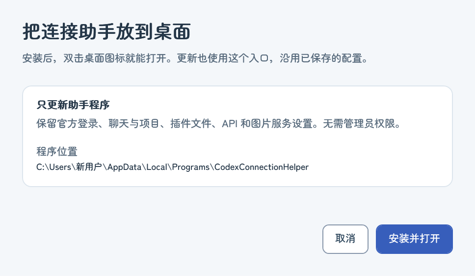
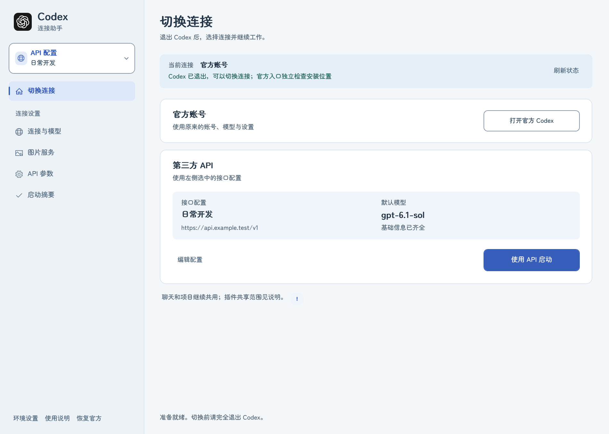
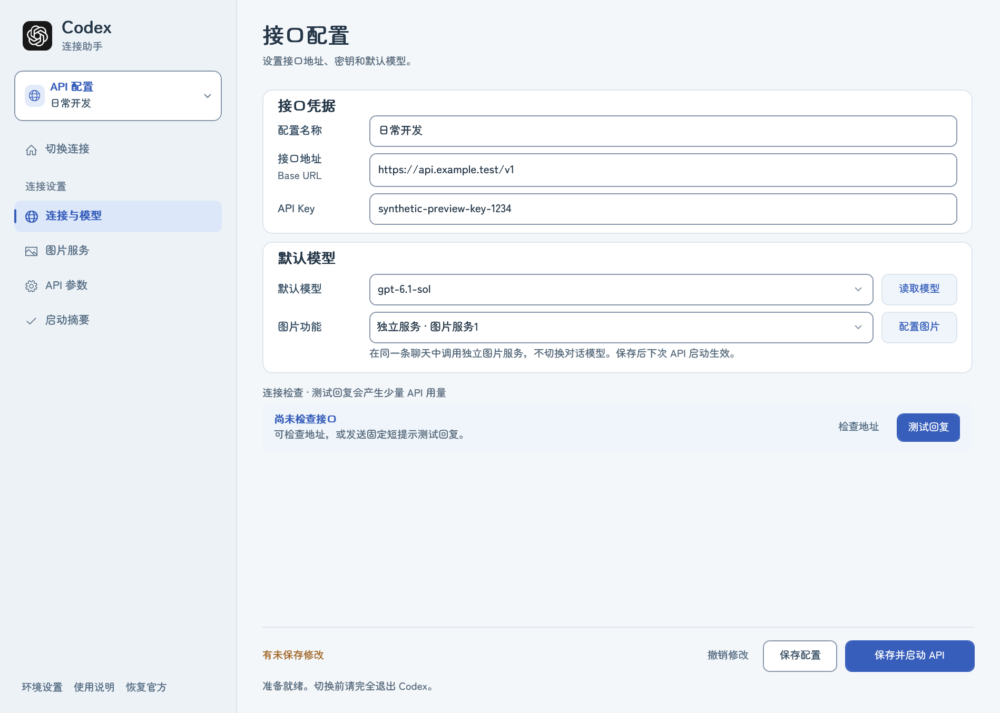
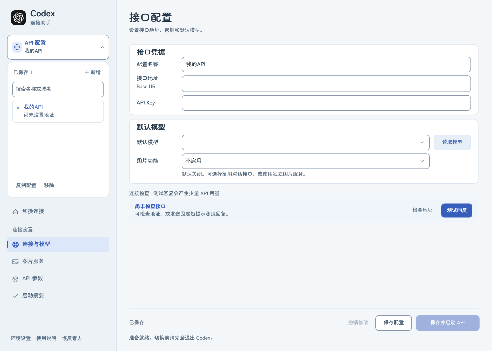
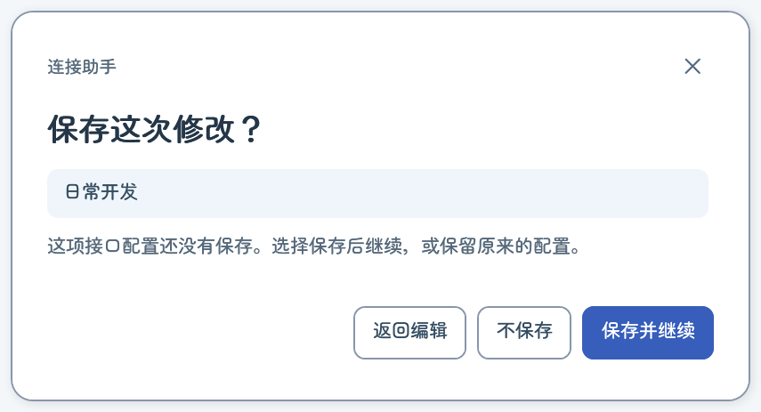
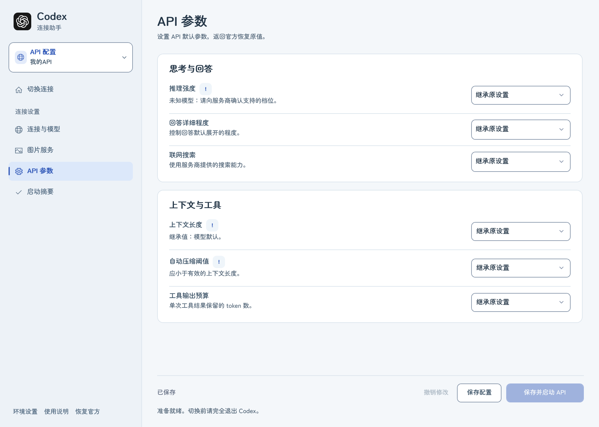
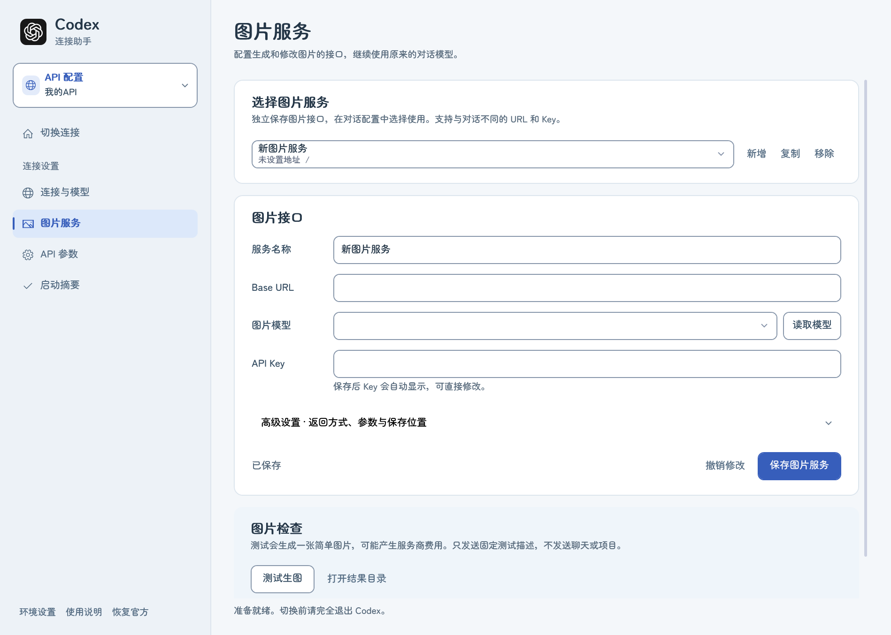
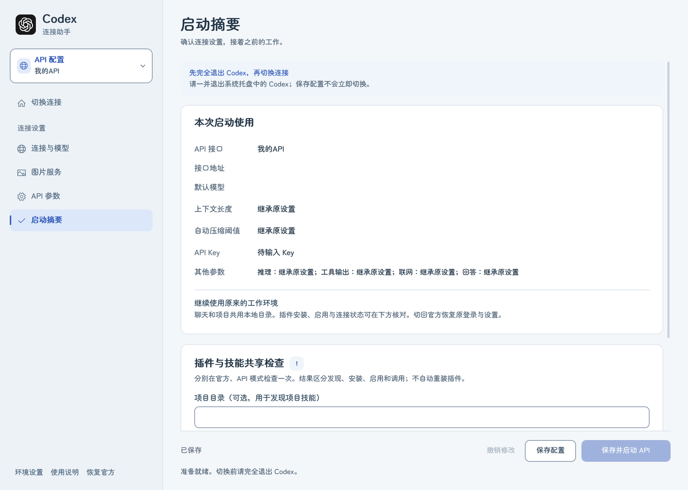
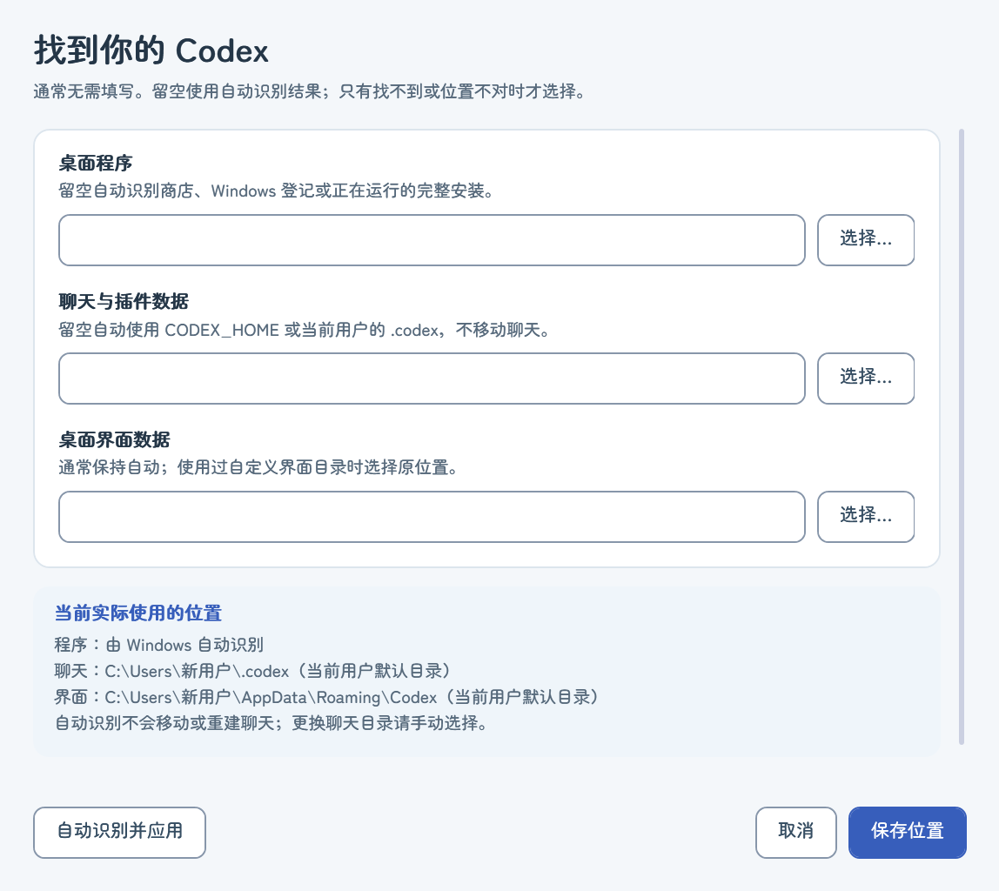

# Codex 连接助手 · 0.3.18

轻量的 Windows 连接管理工具。配合官方 Codex 桌面版使用，在官方账号与多个兼容 API 之间切换，继续同一份本机聊天和项目。

**当前为 Windows 测试版。** [下载 v0.3.18](https://github.com/EEAA-us/codex-connection-helper/releases/tag/v0.3.18) · [反馈问题](https://github.com/EEAA-us/codex-connection-helper/issues)。完整解压 ZIP，双击 **Setup.exe**，点 **安装并打开**。安装会创建桌面图标，以后双击 **Codex 模式切换** 即可打开，无需运行命令或打开终端。首次使用前，请先正常打开官方 Codex，完成登录及数据目录初始化。

## 安装与更新

安装在当前 Windows 用户的 `%LOCALAPPDATA%\Programs\CodexConnectionHelper`，无需管理员权限。下载新版后，关闭旧版连接助手，完整解压新版 ZIP，再双击 **Setup.exe**；它更新同一个程序目录和桌面图标，原来保存的 API 与图片服务配置继续使用。更新不要求退出正在使用的官方 Codex。

安装器只复制公开程序清单中的文件，原程序会保留备份；复制失败会尝试还原。它不更新 `%LOCALAPPDATA%\CodexLauncherSafe` 的用户设置，也不更改 `.codex` 中的官方登录、连接配置、会话或插件。正常官方/API切换仍由助手单独执行，并要求 Codex 正常退出。



希望便携使用时，完整解压后直接双击 **Launch.exe**；移动便携目录后需重新创建快捷方式。`打开启动器.vbs` 和 `.cmd` 保留为备用入口。

使用 Windows 自带 PowerShell 5.1 与 WPF。需有完整 Codex 桌面安装；CLI 不能替代桌面版。首次使用 API 前，先正常使用官方桌面版初始化数据目录。新用户的接口地址、模型和 Key 均为空，旧用户保存的接口仍会读取。

## 图文上手

以下截图展示全新配置，地址、Key 和模型尚未填写。

### 1. 打开助手

安装后双击桌面 **Codex 模式切换**，或在便携目录双击 **Launch.exe**。首页显示官方账号、选中的 API 和当前运行状态；通常无需填写安装位置。需要切换连接时，先正常退出应用和托盘，再点 **刷新状态**。



### 2. 填写自己的 API

点左侧 **连接与模型**，依次填写配置名称、服务商提供的 HTTPS 地址和 API Key。点 **读取模型**选择默认模型，也可直接填写服务商给出的模型名称。没有图片需求时保持 **图片功能：不启用**。

**检查地址**与**测试回复**用于检查当前输入；测试回复可能产生少量 API 用量。测试通过后，点 **保存配置**；保存不会切换正在运行的 Codex。



需要多组接口时，展开左上方 **API 配置**，使用 **新增、复制、移除**。每组分别保存，选择其他接口前会处理未保存的修改。



### 3. 切换连接与处理修改

正常退出 Codex 后回到首页，点 **使用 API 启动**。回到官方时，同样先正常退出，再点 **打开官方 Codex**。

**撤销修改**还原当前接口的未保存输入。离开页面或关闭助手时，确认窗提供 **返回编辑、不保存、保存并继续**；保存失败会保留当前输入。



### 4. 可选参数与图片服务

默认参数继承原设置，一般可直接使用。需要调整时打开 **API 参数**；参数旁的 **!**解释含义，保存后在下次 API 启动应用。

<details>
<summary>查看默认参数页面</summary>



</details>

需要独立生图接口时，打开 **图片服务**并新增服务，填写图片接口地址、模型和 Key，保存后回 **连接与模型**选择该服务。图片测试可能产生服务商费用。

<details>
<summary>查看尚未填写的图片服务页面</summary>



</details>

### 5. 恢复官方与检查共享范围

恢复连接前先正常退出 Codex，点左下角 **恢复官方**。助手无法打开时，双击文件夹里的 **恢复官方配置.cmd**；若保存的登录也无法恢复，可按提示明确确认重置，然后在官方 Codex 重新登录。聊天与项目不会因此删除。

首页与启动摘要的 **!**说明插件共享范围。带“本地共享”的插件是可复制的纯技能副本，Figma 等账号服务仍需核对自己的连接。



## 安装位置与数据目录

左下角 **环境设置** 显示实际使用位置与来源。**自动识别并应用** 一次点击即保存并刷新结果，无需再点击“保存位置”；已有自定义聊天与界面目录会保留，避免切换到一套空白记录。环境变量仍优先，修改它们需要在 Windows 中处理；助手不会擅自修改系统环境变量。

插件清单检查不再要求桌面界面目录已经存在；有原聊天与插件数据即可检查。默认项目范围为当前用户目录，移动或更新助手文件夹不会改变这个范围。若选了项目目录，请在两种模式检查同一个项目。



| 位置 | 识别顺序 |
| --- | --- |
| Codex 桌面程序 | 手动选择 → 商店安装清单 → Windows App Paths / 卸载登记 / 正在运行的完整安装 |
| 聊天、项目及插件数据 | `CODEX_HOME` → 手动选择 → `%USERPROFILE%\.codex` |
| 桌面界面数据 | `CODEX_ELECTRON_USER_DATA_PATH` → 手动选择 → `%APPDATA%\Codex` |
| 启动器设置与恢复备份 | `%LOCALAPPDATA%\CodexLauncherSafe`，各 Windows 用户分别保存 |

通常无需填写位置。安装在 D 盘也按 Windows 登记的实际位置查找，商店程序从安装清单读取实际 EXE；自动模式每次重新查找，不记住带版本号的路径。其他登记或运行线索仅在找不到商店安装时使用，发现多套有效安装会要求选择。没有任何登记且未运行的便携安装仍可选择 `ChatGPT.exe` 或 `Codex.exe`；会检查旁边的 `resources/app.asar` 和 `resources/codex.exe`。这只能验证目录结构，不保证任意改包或未来版本兼容。手动选择失效时明确报错，不偷偷回退到另一安装。

手动聊天目录必须已经含有 Codex 数据；界面目录必须存在。支持本机盘符完整路径与 `%USERPROFILE%` 等变量展开，不接受相对路径、UNC 网络共享或整盘数据目录。不搜索全磁盘、不移动历史、不设系统环境变量。环境变量优先时，相应选择框禁用；修改环境变量后须重新打开启动器才能读取。

保存位置要求 Codex、托盘及 CLI/后台引擎全部退出。活跃 API 恢复备份绑定原聊天目录，必须先恢复官方才能换到其他数据目录；目录选错时可改回备份绑定的原目录。已恢复的旧目录备份在开始另一目录的 API 切换前留存到 `recovery-archives`。不支持两套数据目录并行切换。

错误路径配置不会让窗口无法打开，可在环境设置重新保存；旧 `paths.json` 会先备份。电脑更换用户后，须重新填写自己的 Key；本机加密凭据不具备跨用户迁移能力。

## 使用

1. 安装后双击桌面 **Codex 模式切换**，便携使用双击 **Launch.exe**。默认进入 **切换连接** 首页，可查看已应用的连接配置和 Codex 运行状态。
2. 原来的单接口设置会自动读入。展开左上方 **API 配置**，点 **＋ 新增** 可新增配置，填写自己的名称、HTTPS Base URL、Key 和默认模型。
3. 点 **读取模型**。精确匹配本机模型元数据的模型会进入 Codex 原生菜单；未知别名仍可手动输入默认模型，能力需自行验证。
4. 可在 **API 参数** 页调整推理强度、回答详细程度、搜索、上下文长度、自动压缩阈值和工具输出预算。默认继承官方原值。推理强度是下次 API 启动的默认值，进入聊天后仍可在 Codex 右下角调整。
5. 保存只更新启动器配置。完全退出 Codex（含托盘）及 Codex CLI/后台引擎后，在首页点 **刷新状态**，再点 **启动选中的 API**；配置页的 **保存并启动 API** 使用同一个启动流程。
6. 回官方时同样先退出，刷新状态，再点 **打开官方 Codex**。原连接与受管理参数会恢复，其他设置继续保留。

**Ctrl+S** 保存配置；切换接口或关闭窗口时会提示未保存修改。**撤销修改** 还原当前接口的未保存输入，不改变保存的配置和密钥。**恢复继承值** 将高级参数设为继承，保存后下次启动应用。

左上方 **API 配置** 默认显示带图标与边框的选择卡片，含当前配置名称。点击向下展开，选择其他接口或搜索名称、域名；新增、复制和移除也在展开区域。选择接口后自动收起，按 **Esc** 也可收起。搜索不会丢失当前编辑内容；收起时清除搜索条件。

新增和复制 API 配置会自动使用未占用的编号。已有同名配置在选择列表中显示前置编号，方便区分；保存的名称、ID、Key 和绑定不改写。

只有连接与模型页显示 **连接检查**，**检查地址** 和 **测试回复** 始终可见，无需展开。检查地址读取模型列表，不发送聊天内容；模型列表成功不等于模型能生成。测试回复使用当前地址、Key 与默认模型，经过与 API 启动相同的本机兼容链路，发送固定短提示，要求有效文本与明确的 Responses 完成事件同时成立才显示“连接成功”。

测试回复可能产生少量服务商 API 用量，只在点击时发送，不发送原聊天、项目、工具或其他文件，不切换当前 Codex 登录，也不保存当前接口草稿。请求使用 512 token 输出上限；已知模型可用时选择较轻的推理档位，不验证当前高级参数的完整行为。兼容模块启动最长 15 秒，请求最长 45 秒，可在任意页面点 **取消检查**；取消停止本机等待，不能撤销已经产生的服务商用量。

等待时显示兼容模块启动、服务商响应、生成和完整收尾阶段及已用秒数；收到文字也不会提前显示成功。结果显示检查时间、HTTP 状态和请求耗时。401、403、404、429、超时、协议不兼容、残缺回复等分别提示；不展示服务商原始报错、密钥或回复正文。修改配置/密钥后旧结果失效，关闭窗口取消未完成检查。HTTP 200、本地文字输出或仅 [DONE] 都不能单独证明成功。此检查不验证工具调用、长上下文、桌面侧栏及通知，超时也不等于接口永远不能使用。完成事件依据 [OpenAI 官方流式文档](https://developers.openai.com/api/docs/guides/streaming-responses)。

首页展示连接状态与启动入口。连接页将接口凭据与默认模型分开，**启动摘要** 提供只读确认；界面采用雾蓝画布、白色面板、樱粉点缀和 GPT 原生编织标识；默认窗口为 1280 × 940 DIP，左侧配置区加宽至 300 DIP；窗口可缩放并自动适配屏幕，内容超出时可滚动。请保留 UI.xaml 文件。

推理强度列表依据本机模型元数据。换模型后不支持的原档位会保留为“需调整”，并禁止启动，重新选择即可。未知模型展示常见档位，实际能力需向服务商确认。已有聊天可能保留自己的选择，不保证启动默认值覆盖现有聊天。设置行旁的 **!** 可点击查看说明，点击关闭、窗口外部或按 Esc 收起。

## API HTTP 兼容

0.1.2 在 API 模式启动一个绑定 127.0.0.1 的兼容模块。它拒绝 WebSocket 升级，让已验证的 Codex 引擎回退到 HTTP，再通过 HTTPS 向选中的服务商转发 Responses 请求。仍使用内置 openai 供应商身份和原来的数据目录，以保留原聊天的显示与续接。

模块使用 Windows 内置 .NET，不额外安装程序。只允许固定的模型和 Responses 路由；验证临时本机凭据，拒绝浏览器 Origin，不记录密钥、聊天或请求体。Codex 退出后模块也退出。API 模式每次须经启动器打开；重启电脑后再点击“保存并启动 API”，会重新建立连接，已保存的接口和参数不受影响。

0.1.4 识别 Responses 的明确完成事件并及时收尾。部分接口只返回 `[DONE]` 时，仅在响应身份与全部输出项完整、没有失败标记的情况下补齐完成事件；不会从文字、超时或断线猜测成功，也不会补造 token 用量。残缺流仍按错误处理。

请求体上限 32 MiB，认证后单请求最长 20 分钟。仅处理标准 HTTP Responses，不转换 Chat Completions，也不保证所有服务商的工具/压缩能力。第三方模型目录关闭未验证的 Responses Lite 标记，原官方模型缓存保持不变。

## 与官方配置的边界

- Codex 负责聊天、项目、工具权限、插件安装及原生模型/推理菜单。
- 启动器负责接口、凭据备份及明确列出的 API 参数，不做界面注入或后台自动切换。
- 两种模式直接使用同一 CODEX_HOME 与桌面界面目录，不复制、合并或改写聊天数据库/历史文件。
- **API 模式会暂时修改 config.toml 中的连接参数和 auth.json。** 返回官方时恢复备份。这不是官方配置完全不变的方案，也不提供两个客户端同时运行的实时同步。
- 受管理键：model、model_provider、openai_base_url、model_catalog_json、cli_auth_credentials_store、forced_login_method、service_tier，以及上述六类 API 参数，其中包含 model_reasoning_effort。推理强度选择继承时沿用原值，显式选择时只在 API 模式应用，回官方恢复；其他配置不由启动器覆盖。
- 检测到已有 API 连接的登录或路由被外部工具修改时，普通切换停止。显式恢复会先确认。切换中断也会提示恢复，避免继续使用不确定的连接。

## 数据与密钥

启动器偏好、多接口设置、模型目录和恢复备份位于 `%LOCALAPPDATA%\CodexLauncherSafe`。

- profiles.json：每个接口分别保存加密 Key 和参数。
- shared-switch.json：官方凭据与原连接参数的加密恢复备份。
- profile-backups / config-backups：历史配置备份。
- catalogs：按接口隔离的原生模型目录。

Key 的启动器副本和官方登录备份使用当前 Windows 用户的 DPAPI。API 模式下，Codex 标准 auth.json 中保存的是本机兼容模块的临时凭据；服务商 Key 通过进程管道传入模块，只用于内存中的上游 HTTP 请求。不要分享自己的数据目录；只分享干净的启动器文件夹。

默认原数据目录为 `%USERPROFILE%\.codex`，界面目录为 `%APPDATA%\Codex`。显式 CODEX_HOME / CODEX_ELECTRON_USER_DATA_PATH 会被尊重；恢复备份绑定其原目录，目录不匹配时停止切换。

## 恢复与快捷方式

完全退出 Codex（包括托盘和后台引擎），点 **恢复官方**。这只恢复，不启动应用。换行变化不再算作图片配置冲突；明确恢复时，如果当前配置无法安全合并，会先留存当前配置与登录的加密快照，再恢复切换前的完整官方配置。其他工具在切换后追加的设置仍在备份中。

助手主窗口打不开时，双击同目录 **恢复官方配置.cmd**。它不读取 API 配置列表、图片服务设置，也不依赖官方安装位置发现，使用恢复记录绑定的数据目录。恢复仍要求应用正常退出；备份损坏、文件无写入权限或官方令牌已失效时不能承诺直接登录，会保留文件并显示具体原因。

**Setup.exe** 自动创建桌面入口。便携目录可用 **修复桌面快捷方式.cmd** 重建入口；图标复制到固定的本机缓存，不依赖官方应用的版本目录。

启动器窗口使用独立任务栏身份和当前 logo，避免归到 PowerShell 图标下面。移动文件夹后重新运行快捷方式修复；旧启动器窗口需正常关闭，再打开才能使用新版任务栏身份。不需要因此重启 Codex。

## 官方应用身份与账号能力

0.1.8 在已登记的官方安装、默认数据目录且没有连接/目录环境变量时，使用 Windows 的官方应用激活入口，身份从当前安装清单动态取得。官方应用图标来自自己的安装登记；连接助手的图标不传给它。升级或安装在其他磁盘时重新发现，不写死版本路径。实际任务栏和弹窗仍需重新启动后观察。

Windows 激活接口不能传入独立环境块。手动数据目录、连接/目录环境变量或未登记的完整安装继续使用原来的子进程启动，保留路径与凭据隔离；不会为了外观静默忽略目录选择。此类环境不能仅凭路径测试宣称任务栏与默认安装完全一致。

共享插件文件不代表共享官方账号的安装记录或云端授权。官方文档说明 OpenAI API Key 登录支持一部分精选插件，部分 OAuth 连接不支持；第三方服务商 Key 也不是 OpenAI 插件服务的授权凭据。助手不删除官方插件、不伪造 ChatGPT 登录、不注入应用来强行显示隐藏入口。[插件能力说明](https://learn.chatgpt.com/docs/plugins#api-key-availability)。

原生完成提醒有“关闭／仅应用失去焦点时／始终”选项；默认失焦条件针对整个应用，不能简单理解成切到另一个聊天。侧栏未读点和系统弹窗是不同状态。本次没有改原生提醒设置或另造一个助手弹窗来冒充官方通知。[提醒说明](https://learn.chatgpt.com/docs/notifications)。

## 准备 GitHub 分享目录

在此文件夹运行下列命令，目标须尚不存在：

```powershell
powershell.exe -NoProfile -ExecutionPolicy Bypass -File .\Prepare-Share.ps1 -Destination ..\Codex-Launcher-Share
```

脚本只复制固定公开文件清单，逐项校验，不复制 AppData 中的 Key、登录、路径设置、聊天或恢复备份，也不制作安装包。`.gitignore` 再排除这些本机数据。分享完整的生成文件夹；接收者运行自己的快捷方式修复入口并填写自己的 API。

项目仓库：[EEAA-us/codex-connection-helper](https://github.com/EEAA-us/codex-connection-helper)。公开仓库不表示已授予代码的开源许可；代码许可证尚未指定。字体按 OFL 单独分发，当前使用的 OpenAI 图案来源列在 NOTICE.md，未声明为本项目原创。开发验证见 CONTRIBUTING.md。

## 兼容范围与验证

第一版使用 Windows 自带 PowerShell 5.1 与 WPF，无额外运行时或组件安装。标准 Windows 应用包自动识别；未登记的完整安装可手动指定。macOS/Linux、网络共享目录及仅有 CLI 的环境不支持；不自动适配只支持 Chat Completions 的接口。未逐个平台、架构和非标准安装进行实机验证。

上下文支持整数、200K、1M；K 为 1,000，M 为 1,000,000。设置不会增加服务商的真实窗口。API 参数按接口保存，切换模型后请确认参数与模型能力匹配。已有聊天可能保留自己的模型/推理选择。

已验证多接口隔离、旧设置迁移、界面操作、取消后保留编辑、外部修改保护、官方恢复、原生模型列表、实际 app-server 的参数加载与同一聊天往返续接，以及 CCTQ / gpt-6.1-sol 的简短真实请求。未在真实桌面聊天中退出应用做完整往返，也未逐个验证其他接口、模型及依赖官方云端账号的插件。

## 设计参考

参考了 [Anthropic frontend-design](https://github.com/anthropics/skills/blob/main/skills/frontend-design/SKILL.md)、[Vercel Web Interface Guidelines](https://github.com/vercel-labs/web-interface-guidelines) 、[UI/UX Pro Max](https://github.com/nextlevelbuilder/ui-ux-pro-max-skill) 和 [Codex++](https://github.com/BigPizzaV3/CodexPlusPlus) 的设计原则与信息组织。界面代码独立编写；没有安装这些技能或修改官方插件目录。这轮另参考 [Fuwari](https://github.com/saicaca/fuwari) 与 [Shiro](https://github.com/Innei/Shiro) 的柔和视觉和留白，保留 WPF 实现。更多见 DESIGN.md。

官方参数依据：[配置参考](https://learn.chatgpt.com/docs/config-file/config-reference)、[身份验证](https://learn.chatgpt.com/docs/auth)、[聊天恢复协议](https://learn.chatgpt.com/docs/app-server)。

## 插件授权与完成状态

同目录下的插件文件、原生安装记录、启用状态和账号连接分别判断；第三方 API Key 不等同官方账号的授权。API Key 模式能用哪些插件取决于官方支持和连接方式，详见 [官方插件说明](https://learn.chatgpt.com/docs/plugins#api-key-availability)。本机已有的 GitHub CLI 或独立 MCP 使用各自的登录方式。

兼容模块在 `%LOCALAPPDATA%\CodexLauncherSafe\http-diagnostics.jsonl` 记录时间、HTTP 状态和结束事件是否完整等诊断信息，不记录消息、Key、会话 ID、接口地址或工具参数。只修复符合严格条件的协议缺项；桌面通知仍遵循 Codex 的通知设置与窗口焦点策略。已用当前桌面引擎 0.162.0-alpha.2 验证模拟缺项恢复与 CCTQ 的一轮真实短对话完成事件；真实桌面弹窗和长项目任务仍需实际确认。

如果输入框已经恢复发送按钮，但侧栏仍转圈，应分别检查回复完成与侧栏状态。当前桌面程序的侧栏还会参考任务运行状态及关联任务；这项显示故障尚未复现或解决，不能仅凭文字已经出现认定原因。隔离的 CCTQ 测试已收到 `turn/completed`、`thread/status/changed` 的 `idle`，且 `thread/read` 返回 `idle`，只证明引擎结束状态正确，不证明桌面侧栏或弹窗正常。下次正常退出 Codex（含托盘）后，经启动器打开 API，再用一句简短消息验证；通知测试需符合 Codex 自身的通知设置和窗口焦点条件。无需为了检查立即中断正在使用的官方对话。


## 2026-10-10 界面更新

本次实际使用 Design Partner 技能重组首页、统一文字与输入控件、增强键盘焦点；功能继续由内置 WPF 和现有脚本实现。用户运行本工具无需安装设计插件。Figma 账号接口仍未连接，未生成 Figma 设计稿。验证与边界见 DESIGN.md。

## 回复测试反馈

0.1.9 检查期间保持普通鼠标，等待阶段和秒数显示在页面中。真实回复测试结束时，窗口顶部显示软件内提示：成功和取消约 8 秒后收起，悬停或键盘焦点在提示内时暂停收起；失败保留到点击关闭或按 Esc。提示不抢焦点、不调用系统通知；原位置保留详细结果。开始新检查、修改相关配置或切换接口后旧提示会收起。

0.3.14 中，普通检查信息使用蓝色提示，明确成功才显示绿色对勾。长提示显示摘要，可点 **查看详情** 打开软件同风格的完整内容窗口。API 已请求启动时，可选图片功能的提醒不会再显示成整个启动失败；插件和图片提醒一并保留。

插件摘要按实际清单显示数量，不固定突出某个插件。展开安装、技能与连接明细后可在明细内滚动查看全部条目；没有取得清单时显示未完成，不据此认定插件未安装。

0.3.15 将助手创建的纯技能副本显示为 **原名称 · 本地共享**，例如 **Design Partner · 本地共享**。官方原版本继续使用原名称。重新打开助手会自动更新仍与来源一致的旧副本和其安装缓存；更新前留存旧显示配置，不卸载或停用插件。原生窗口已加载的名称可能需要重新打开插件页或下次正常启动才能刷新。

这项更新用于区分两个来源，插件 ID、版本、技能和登录不变。Figma 等服务的账号连接属于另一层；同名连接不能仅凭名称自动删除。

在首页共用提示旁，或 **启动摘要 → 插件与技能共享检查** 标题旁，点击 **!** 查看共享范围：助手只自动共享已安装启用、允许复制（MIT 许可）的纯技能插件；含账号服务连接的插件需要单独核对。没有本地副本不表示 API 模式一定不可用，清单读取成功也不等于所有插件都能调用。

说明使用软件内小窗，可点关闭或按 Esc 返回原按钮，切换页面自动收起；长内容可滚动。页面标题右侧的装饰点已移除。

## 图片功能 · 0.3.0

在 **连接与模型 → 图片功能** 选择：

| 方式 | 使用方法 |
| --- | --- |
| 不启用 | 默认选择，保持普通聊天 |
| 使用对话接口生图 | 复用此连接配置的地址、Key 和模型，要求服务商支持 Responses `image_generation`。显示实际使用模型，不跟随右下角临时切换 |
| 独立服务 | 在左侧图片服务新增地址、图片模型和 Key，再在连接页选择此服务 |

独立服务填 Base URL，例如 `https://example.com/v1`，不要填完整的 images/generations。可读模型列表或手动填写；能读到模型不代表生成成功。独立图片服务直接填写对应 Key，保存后自动回显。新增、复制名称自动编号；保存时拒绝重名，历史重名在备份后的下次保存修正，绑定 ID 不变。

新服务默认 **自动识别**：只提交一次普通 Images 请求，返回图片就保存，返回已支持的图片任务就先保存编号再轮询。不懂同步/异步可先保持默认。高级设置中可选择同步返回或异步任务；强制异步附加 `async=true` 并要求 `/images/tasks/{id}` 查询合同。相同服务可能同时支持两种方式，旧配置保留原选择。未知任务格式保留本地任务记录，不猜测查询地址、不自动重新提交。

尺寸、质量、格式、背景和网络方式放在高级设置，留空参数不发送。等待时长默认 600 秒，独立服务可设 60–1800 秒；提交、查询、下载共用上限。保存目录默认当前 Codex 数据目录的 `generated_images/launcher`。

保存后，正常退出 Codex/托盘及后台引擎，通过助手启动 API 加载图片 MCP。原聊天可以说“用配置的图片工具生成图片”；改图时提供本机参考图。普通对话模型需要支持工具调用，图片生成和修改遵循 Codex 的权限流程；图片模型不用放进对话模型菜单。最终项目资产可让 Codex 复制进工作区。

**测试生图可能收费**，只发送固定测试描述，不发送聊天、项目或保存草稿。使用普通鼠标、阶段计时、取消、窗口顶部提示和本地预览。取消只停止本地等待；返回 `can_resume=true` 时用 `resume_image_task` 和本地 job_id 续取，不能用新的生成代替。收到完整图片结果后即使下载中断，也会保留结果以供续取。未收到编号/图片结果的请求无法保证续取。

首版支持兼容 Images 的 base64/URL 返回、`/images/tasks/{id}` 任务轮询，以及 Responses 图片工具的非流式结果。私有任务格式、特殊签名、Midjourney 和图片 SSE 不在此版范围。不会在协议失败时自动切换接口重复付费提交。

实际验证：现有站点的 `gpt-image-2` 普通 Images 请求约 23 秒生成并下载，未强制异步；此前强制异步的生成和参考图修改也已完成。Responses 的图片别名返回了图片；普通对话模型 `gpt-6.1-sol` 本次没有返回图片工具结果，因此本站目前推荐 **独立图片服务**。该限制不能推广到所有中转站。JojoCode 等其他地址尚未实测。[官方图片工具协议](https://developers.openai.com/api/docs/guides/tools-image-generation)

服务、加密运行快照和任务在本机 `image-services.json`、`image-runtime`、`image-jobs`，不参与分享。已完成任务移除保存的 Key，未结束任务保留加密凭据以便续取。API 启动只管理自己的 `mcp_servers.codex_launcher_images` 区段，保留其他 MCP；切回官方移除此区段并禁用旧工具。冲突时停止覆盖，图片配置无效时普通聊天仍可启动。

新增 `image_mode` 使用方式；旧配置有绑定则沿用独立服务，否则关闭。回退到不支持图片工具的旧版本前，先用新版恢复官方。原生桌面同一聊天的自动图片调用仍为 **unobserved**，工具发现、独立接口实测不代替它。

## 插件与技能共享检查

在 **启动摘要 → 插件与技能共享检查** 点“检查当前模式”。项目目录可选，用来发现该项目的技能。在官方和 API 模式分别检查一次，选择同一个项目，助手会比较同一份本地目录与原生安装清单；另一模式未检查时明确提示。不要为了检查强制结束当前工作。

摘要显示 Figma 安装/启用情况；折叠明细显示插件来源、技能路径和范围、MCP 认证/工具数量以及 App 运行快照。实际调用始终单独标为未观察，独立诊断进程的 App 清单不代表当前桌面聊天。接口不支持、查询失败或清单不完整时标记 unobserved，不推断为被禁止。

本机官方模式实际查询到两个 Figma 来源：本地市场条目未安装，账号管理条目已安装并启用。因此缓存文件、市场可搜索和账号安装登记不能混为一谈。第三方模式的差异仍需该模式的实际清单才能定位。

两种模式都完成有效检查、项目和数据目录相同后，可出现 **安装或修复所选本地插件**。来源包括上一模式已安装但当前缺失的本地条目，以及官方账号已安装、API 市场中同名且明确可用的本地版本。页面先显示具体来源；用户点击后，正常退出 Codex，由官方接口单独安装，配置先加密备份。提交前再次核对原生登录，安装后确认本地安装清单；失败或未确认不显示成功。不会自动重装所有插件、复制账号 Token 或伪造云端安装记录。

账号管理的 Figma 与本地市场版本有各自的安装记录；在市场找到它不能证明本地版本已安装。API 模式可能需要安装本地版本并完成其 Figma MCP 连接，官方账号的 App 授权不会由助手复制。安装记录、启用、连接和实际调用分别核对；不要把本地安装成功当成所有功能均可调用。[官方 API Key 插件范围](https://learn.chatgpt.com/docs/plugins#api-key-availability)

**当前已观察的限制：** 本机原生引擎 `codex-cli 0.162.0-alpha.17.2` 在隔离 API Key 模式安装官方精选 Figma 时，明确返回“API Key 不支持远程插件市场安装”，结果为 blocked。助手已修正精选市场缓存被误当成普通本地市场的安装入口；原生登录限制仍不能由助手消除。该限制不能推广为所有插件、版本或用户均不可用，也不能宣称真实第三方 Figma 已共享。受限时软件明确提示原因并停止重复操作，本地 MCP 的认证和使用需单独验证。

## 0.3.9 自动共享与官方保底

启动 API 时，会用原生清单核对已安装、启用且实际发现的本地技能。对已缓存的 MIT 纯技能插件，自动保留完整技能资源、许可和来源，通过原生本地市场接口登记安装。本地来源显示为“本地共享 · 插件名”，不会伪造官方账号安装记录；同内容复用副本。Design Partner 的实际生产流程已在隔离 API 环境确认安装与启用技能；本机官方只读发现也能识别它。当前真实 API 桌面显示和模型使用仍待正常切换后观察。

带 App/MCP、未知许可、停用或未确认来源的插件不自动复制授权或启用。插件检查/共享失败只提示，普通 API 聊天仍可启动；连接启动在后台处理，鼠标保持普通箭头。其他插件需要按其来源和连接能力分别检查。

API 配置损坏不会让助手主窗无法打开，原文件保留，重新保存前确认并备份。官方入口不依赖 API 草稿、图片服务或坏的手工安装位置；优先恢复绑定的数据目录，再自动发现官方安装。独立 `official-recovery.json` 保存加密官方快照，切换记录丢失/截断或主备份损坏时可从独立副本恢复完整配置。旧版本在下次正常 API 切换时建立该副本。

若两份记录都不可用，软件询问 **“重置连接并重新登录官方？”**。确认后先加密备份当前配置、登录和记录，清除 API 连接与本地登录文件，并使用官方登录配置；聊天、项目文件保持原位。其他设置可以从备份找回。这是重新登录入口，不能把它写成旧账号凭据已恢复。取消不写入。独立恢复脚本也提供相同确认；命令行显式重置为 `powershell.exe -NoProfile -STA -File Restore-Official.ps1 -ResetLogin`。

应用仍需正常退出后再切换；磁盘离线、写入权限或官方登录服务故障会明确提示。助手能解除自身配置造成的阻塞，不能代替 Windows 安装或官方账号登录服务。建议小范围测试分享。

诊断摘要位于本机 `compatibility`，加密修复备份位于 `plugin-repair-backups`，均不进入公开分享。不读取聊天正文，不保存原始接口响应、工具说明或账号凭据。[官方插件能力说明](https://learn.chatgpt.com/docs/plugins#api-key-availability)

## 界面与确认提示 · 0.3.6

明亮日系界面使用随软件携带的「寒蝉半圆体」，无需安装字体，也不依赖网络字体。地址、模型名和路径也使用同一字体；缺失字形才回退到系统字体。连接检查只展示在“连接与模型”页。错误通过顶部软件提示显示，底部不重复错误正文。字体授权及来源见 fonts/OFL.txt 和 NOTICE.md。

保存修改、移除配置和恢复冲突使用助手自己的确认小窗。保存提示的三个操作分别是「保存并继续」「不保存」「返回编辑」；按 Esc 或关闭小窗等同返回编辑。保存失败保留草稿，不继续原操作。移除和恢复默认聚焦取消。

图片页分开显示服务选择、接口设置与图片检查；高级设置保持折叠。环境设置、说明卡片、下拉菜单与顶部提示共用主题。测试结果仍显示在软件内，完整结果保留在页面。文件和目录选择使用 Windows 选择器。


## Key 回显与检查布局 · 0.3.6

对话和独立图片服务的 Key 默认显示，保存、重开配置或切换回来后仍自动回显，可直接编辑。取消显示密钥开关及图片服务的引用当前对话 Key 选项；本机文件继续加密保存。回显值不会导致已保存配置被当成未保存。地址变化时仍要求明确填写对应 Key。

旧版共享图片配置继续兼容；打开页面可读取适用的旧凭据，明确保存后转换为独立图片 Key，不自动改写已有绑定。连接页的检查按钮直接显示，默认内容在 1280×940、1080×760 窗口均可显示完整，无须右侧滚动条；长内容或其他设置页仍可滚动。

## 字段和检查操作 · 0.3.6

输入框使用一层较紧凑的内边距；模型输入与名称、地址、Key 左端对齐，小写 g 保留完整字形。连接地址检查、读取模型和测试回复期间，可切换到 API 参数页并编辑当前草稿。保存、切换连接、重复测试与切换配置在检查结束后恢复。检查使用开始时的配置；如果等待时有修改，结束时标为配置已修改，不将旧结果用于确认新配置，也不覆盖草稿。

插件检查从原生 account/read 核实登录方式，刷新令牌关闭。切换记录与实际登录不一致时明确提示；只有登录方式已确认的两份清单才用于比较。旧版清单缺少原生登录核实，需在官方和 API 模式正常切换后重新检查。插件安装、启用、工具发现和实际调用仍分别判断。API Key 模式支持部分插件，并不保证账号管理插件授权能共享，见[官方说明](https://learn.chatgpt.com/docs/plugins#api-key-availability)。

0.3.6 继续修正小写 g 尾部：输入框与图片服务列表共用更完整的字体行空间，原字体文件不变。首页模型名称按视觉大小补偿，与左侧接口信息保持相近的显示大小和相同行高。

0.3.6：撤销修改还原当前接口最后保存的值，包含可编辑下拉框显示文字；按钮常驻，无修改时禁用，恢复后顶部提示。读取模型、配置图片和对话生图测试共用对齐的操作列。输入框、下拉框、面板和弹窗描边按窗口 DPI 取整数屏幕像素，修正左右粗细不同与取消按钮缺边。

## 配置一致性与恢复 · 0.3.7

图片 MCP 按整段实际字段值核对：换行、空格、注释、字段顺序和等价字符串/数组写法不会被当成外部修改。仅支持助手生成配置的明确 TOML 子集；额外字段、未知语法、重复区段或真正更改的命令/参数仍停止普通切换，不覆盖原文件。

已登记的图片区段完全缺失时，在登录和对话接口仍匹配的前提下，下次从助手启动 API 会按当前保存的设置重建，并给出软件内提示。恢复官方时无需重建图片区段。启动和恢复都会回读实际配置与登录文件，确认一致才标记完成；中断或回读失败保留未完成状态和恢复备份。

遇到真实冲突，正常退出 Codex、托盘和后台引擎后，点击 **恢复官方配置**；助手先保留加密备份再恢复。主窗打不开可运行同目录 **恢复官方配置.cmd**。备份不可读取、权限不足或官方令牌失效时，仍需解决对应问题。这些分支已通过隔离模拟检查，用户报告的短暂报错尚未复现，真实官方/API 往返为 unobserved。

## 0.3.10 启动修复

修复 API 后台启动参数与 PowerShell 只读 HOME 变量冲突。接口、Key 和模型无需重新填写。后台按实际成功或失败结果显示提示，不再因已处理的错误历史误判；插件检查超时、引擎退出分别说明，不统一归因为网络或安装。

Windows PS5.1 检查直接执行生产后台脚本及其结果处理，覆盖真实模块初始化、目录传递、成功、已处理提示和失败；桌面启动及真实账号切换仍需单独观察。

## 0.3.11 中文路径与插件检查

修复原生插件进程输入管道的 Windows 系统编码问题，查询与安装均明确使用无 BOM 的 UTF-8。安装目录或项目目录含中文、空格时，不再因发送路径损坏导致引擎退出。

API 启动与插件状态分别确认：只有原生安装、启用和技能发现同时成立才显示本地安装确认；原生页面与聊天调用仍单独核对。部分查询不再显示成功色。上次启动的本地检查记录保留在摘要中，当前检查失败不会被当成取消安装；记录只在本机，不包含 Key 或账号授权。

## 0.3.12：API 重试与 Design Partner 来源

已处于 API 配置时再次启动，助手先在原目录恢复保存的官方连接，再读取插件来源并应用 API；无需手动切回官方。启动来源检查只读取安装与技能，不等待 App/MCP 连接。关闭旧助手再重开载入新版，切换前仍需正常退出 Codex。

启动摘要区分来源身份、已安装本地版本和实际调用，并保存官方来源清单供 API 对比。Design Partner 本地安装及技能发现已通过隔离重试验证；用户真实 API 插件页和聊天调用仍需核对。Figma 等账号连接不能由该纯技能机制代替。

## 0.3.13：插件提示使用数量摘要

顶部提示根据本次检查结果显示已确认和未确认的插件数量，不逐个罗列名称；启动摘要的明细保留完整名单。插件名称来自实际原生检查，不固定为 Design Partner。旧记录兼容，重新打开助手即可载入新提示。
